<a href="https://shubhanpunde.vercel.app/"></a>

  
  
  
  
  
  
  

I'm a Computer Engineering graduate from **VIT Pune (2026)** working where **identity security, cybersecurity and machine learning** meet. At **RNS Technology Services** I spent a year in Identity & Access Management and presales: hands-on **Saviynt IGA** (application onboarding, entitlements, access reviews), **Zero Trust** controls across identity, endpoint, cloud and network, and Python ML that automated 50% of a risk-detection workflow. Before that I was a **research intern at UNLV** (time-series forecasting) and a cybersecurity intern at Skolar.

I build tools that **end in a decision someone can act on**: allow / step-up MFA / block, a ranked SOC alert queue, approve / decline with reasons. Every project ships with data, CI tests, a baseline to beat and an honest limitations section.

> 🔐 **Portfolio & case studies →** [shubhanpunde.vercel.app](https://shubhanpunde.vercel.app/)  
> Identity risk engine, PhishGuard, explainable IDS, Saviynt IGA work and 15 project write-ups, each with the numbers and the limits.

<table>
<tr>
<td width="50%" valign="top">

**🎯 Roles I'm open to**
- IAM / IGA Analyst · Cybersecurity / SOC Analyst
- Security ML / Detection Engineer
- Data Scientist · Fraud & Risk Analyst
- Data Engineer / Analytics Engineer
- Backend / Software Engineer (Python, C/C++)

</td>
<td width="50%" valign="top">

**⚡ Quick facts**
- **1 yr** IAM & cybersecurity at RNS Technology Services
- **Saviynt ISAA** · IBM Data Warehouse Engineer certified
- **3 papers** published, 2 in **IEEE Xplore**
- **13 of 14** projects tested automatically in CI
- **U.S. Citizen** (no sponsorship) · based in Pune · open to India, USA and remote · available now

</td>
</tr>
</table>



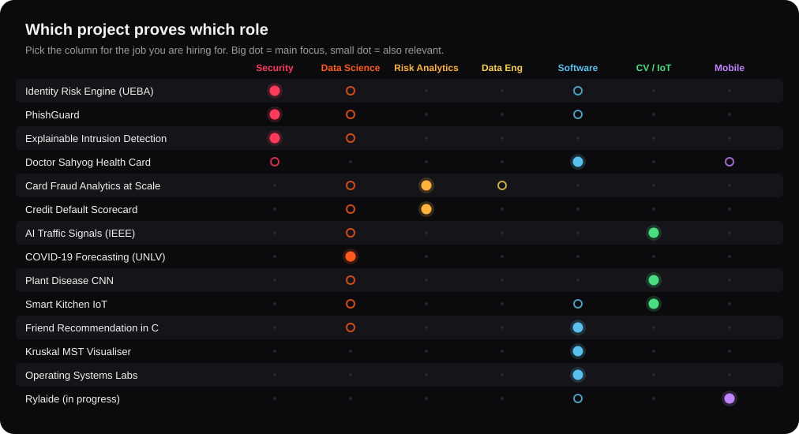

### 🛡️ Security, Detection & Identity (SOC / IAM)
For IAM, SOC and detection-engineering roles: every alert comes with a reason an analyst can check.

<table><tr>
<td width="50%"><a href="https://github.com/Drakeion2532/identity-risk-engine">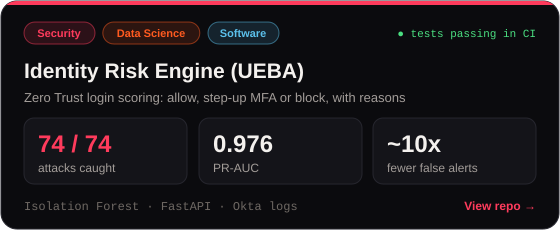</a></td>
<td width="50%"><a href="https://github.com/Drakeion2532/phishing-url-detector">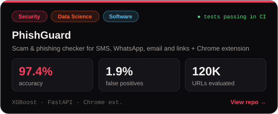</a></td>
</tr><tr>
<td width="50%"><a href="https://github.com/Drakeion2532/network-intrusion-detection"></a></td>
<td width="50%"><a href="https://github.com/Drakeion2532/doctor-sahyog-health-card">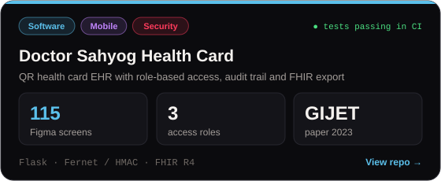</a></td>
</tr></table>

### 💳 Fraud & Credit Risk
For risk analyst, fraud analytics and credit-scoring roles: models judged on business cost and alert budgets, not just accuracy.

<table><tr>
<td width="50%"><a href="https://github.com/Drakeion2532/card-fraud-analytics-spark"></a></td>
<td width="50%"><a href="https://github.com/Drakeion2532/credit-default-scorecard">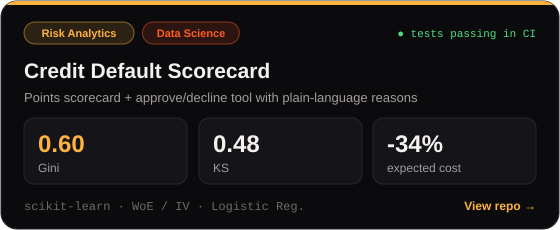</a></td>
</tr></table>

### 📈 Data Science, Computer Vision & IoT
For data scientist and ML engineer roles: forecasting, deep learning and edge ML, each beaten against a baseline.

<table><tr>
<td width="50%"><a href="https://github.com/Drakeion2532/Traffic-Management-using-Deep-Learning"></a></td>
<td width="50%"><a href="https://github.com/Drakeion2532/covid19-time-series-forecasting"></a></td>
</tr><tr>
<td width="50%"><a href="https://github.com/Drakeion2532/plant-disease-detection-cnn"></a></td>
<td width="50%"><a href="https://github.com/Drakeion2532/smart-kitchen-iot">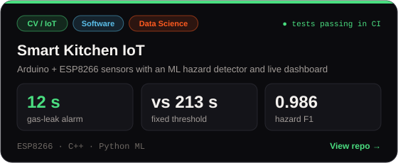</a></td>
</tr></table>

### ⚙️ Software, Systems & Algorithms
For backend and software engineering roles: C/C++ data structures, OS internals and graph algorithms, all tested.

<table><tr>
<td width="50%"><a href="https://github.com/Drakeion2532/Friend-Recommendation-Using-Graph-Data-Structure">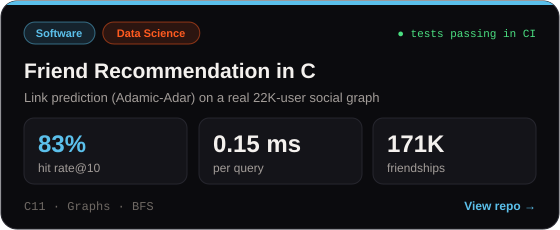</a></td>
<td width="50%"><a href="https://github.com/Drakeion2532/Graphical-demonstration-of-Minimum-Spanning-Tree-Krushkal-s-Algorithm-using-OpenGL">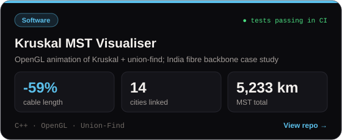</a></td>
</tr><tr>
<td width="50%"><a href="https://github.com/Drakeion2532/OS-Labs">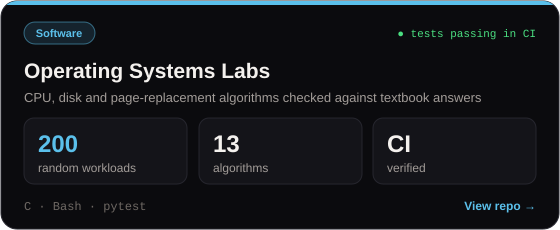</a></td>
<td width="50%"><a href="https://github.com/Drakeion2532/Rylaide">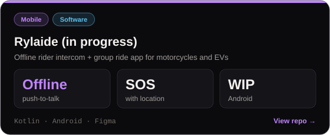</a></td>
</tr></table>

| Job | Tools |
|---|---|
| **Languages** |  + SQL / HiveQL |
| **ML & data science** |       |
| **Big data & BI** |      |
| **Backend & DevOps** |  |
| **Security & identity** |      |
| **Hardware, mobile & design** |  |

| | Publication | Venue |
|---|---|---|
| 📄 | [Real-Time Traffic Management Using Deep Learning and Object Detection using YOLOv8](https://ieeexplore.ieee.org/document/10725412) | IEEE ICCCNT 2024 |
| 📄 | [Multi-Model Ensemble Approach for Enhanced Cyberbullying Detection Across Diverse Categories](https://ieeexplore.ieee.org/document/10823191) | IEEE ICICNIS 2024 |
| 📄 | [Patient Mitra: Health Card](https://openurl.ebsco.com/EPDB%3Agcd%3A3%3A2283619/detailv2?sid=ebsco%3Aocu%3Arecord&id=ebsco%3Agcd%3A171360364&bquery=IS%202395-5287%20AND%20VI%209%20AND%20IP%202%20AND%20DT%202023&page=1) | GIJET 2023 |

**Certifications:** [IBM Data Warehouse Engineer](https://www.coursera.org/account/accomplishments/specialization/E5PB8YR2VWKP) · [Saviynt ISAA](https://certification.saviynt.com/961c5f95-ccc1-4138-a715-f018e287609d#acc.ueJPXyiW) · Data Analyst (GeeksforGeeks) · Querying Databases with SQL

<b>How this profile stays current</b>

The banner, dashboard and project cards are SVGs generated by [`scripts/build_profile.py`](scripts/build_profile.py) from [`data/projects.json`](data/projects.json). A scheduled GitHub Action refreshes the live numbers (repositories, language mix, last activity) every day from the GitHub API.

